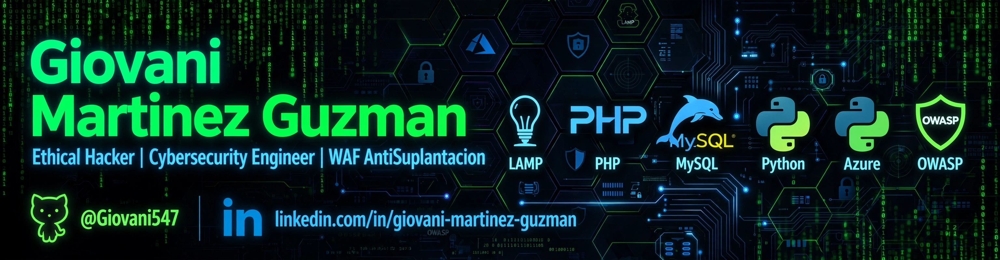

# 👨‍💻 Giovani Martinez Guzman
### Ethical Hacker | Cybersecurity Engineer | WAF AntiSuplantación
> `LAMP Stack` | `PHP` | `MySQL` | `Python` | `Azure` | `OWASP` | `WAF` | `SSIS` | `Anti-Spoofing`

📍 El pedregal MX | GitHub: **@Giovani547** | LinkedIn: **linkedin.com/in/giovani-martinez-guzman**

---

### 🚀 Sobre mí
Ingeniero en Ciberseguridad y Análisis de Datos. Especialista en desarrollo backend seguro con LAMP Stack + Python. Construyo sistemas a prueba de balas: WAF, autenticación robusta y prevención de suplantación.

- 🔭 Actualmente trabajando en: **WAF AntiSuplantación & lanSneakers23**
- 🌱 Aprendiendo: Secure Enclave + Swift + Advanced PenTesting
- 👯 Busco colaborar en proyectos de Ciberseguridad y Backend Seguro
- 📫 Contacto: GitHub @Giovani547 | LinkedIn

---

### 🛠️ Tech Stack
| Backend | Database | Cloud | Security |
| :--- | :--- | :--- | :--- |
| PHP, Python, JS | MySQL, SQL Server | Azure, Vercel | WAF, OWASP, Anti-Spoofing, PII Masking |

---

### 📂 Proyectos Destacados

#### 🛡️ WAF AntiSuplantación - Sistema de Protección de Identidad
Sistema propio para detección y bloqueo de intentos de suplantación de identidad, validación de solicitudes y filtrado de tráfico malicioso en tiempo real. Con reglas custom, rate limiting y logging forense.
`PHP` `MySQL` `WAF` `OWASP` `Security Headers` `Python`

#### 👟 lanSneakers23 - E-commerce Seguro
Tienda online completa con 500+ productos, carrito, pagos y panel de admin blindado contra SQLi y XSS.
`PHP` `MySQL` `JavaScript` `API REST`

---

### 🔗 Conecta conmigo

---
*Hecho con 💚 modo hacker chimba - 2026 | Giovani Martinez Guzman*
